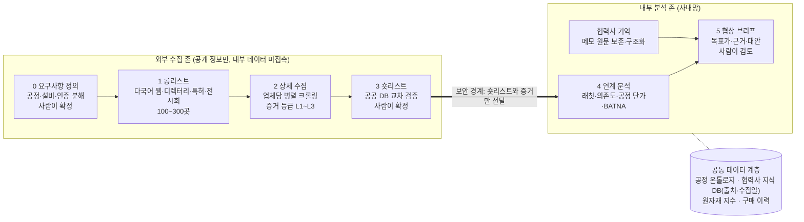

# Second Chair 소싱 에이전트 구현 설계서

작성일: 2026-10-25

## 개요

이 PoC는 8주 안에 품목군 1개를 대상으로, 롱리스트 → 상세 수집 → 숏리스트 → 내부 연계 분석 → 협상 브리프까지 한 번에 이어지는 소싱 에이전트를 검증합니다.

**컨셉: 세컨드 체어(Second Chair).** 협상 테이블에 앉아 있지는 않지만 상대가 계속 의식하는 '두 번째 공급사'를 만들어 주는 에이전트입니다. 업체 발굴은 수단이고, 목적은 모든 협상에 믿을 만한 대안(BATNA)과 근거 있는 목표가를 올려놓는 것입니다.

- **대상 사용자:** 삼성디스플레이 구매팀 담당자와 팀장
- **핵심 가치:** 다변화를 통한 협상 우위, 근거 기반 원가절감, 담당자가 바뀌어도 남는 협상 기억
- **PoC 범위:** 품목군 1개(후보: 아크릴/PMMA 가공품 또는 알루미늄 기구물), 연계 분석 2종(원자재 래칫 탐지, 의존도 역산), 협력사 기억 기능
- **범위 밖:** 실제 RFQ 발송, 계약 체결, ERP 쓰기 작업. 에이전트는 읽고 분석하고 제안만 합니다.

## 설계 원칙

네 가지 원칙이 모든 구현 선택의 기준입니다.

1. **증거 우선.** 수집한 모든 값에 출처 URL, 수집일, 신뢰도 등급을 붙입니다. LLM은 추출하고 판단하며, 사실의 근거는 항상 원문 문서입니다.
2. **에이전트와 결정적 코드의 분업.** 검색어 생성, 사이트 탐색, 문서 이해 같은 비정형 작업은 에이전트가 맡습니다. 필터링, 점수, 원가 계산은 코드와 규칙이 맡습니다. 숫자 계산을 LLM에 맡기지 않아야 결과가 재현되고 검증됩니다.
3. **존 분리.** 외부 수집 존은 내부 데이터를 보지 않습니다. 외부로 나가는 검색어에는 단가나 품목코드 없이 공정·재질 같은 일반 용어만 씁니다. 내부 분석 존은 사내망에서 동작합니다.
4. **사람 확인 지점 3곳.** 요구사항 확정(0단계), 숏리스트 확정(3단계), 브리프 활용 전(5단계)에서 사람이 확인합니다. 나머지 구간은 자동으로 진행합니다.

## 전체 아키텍처

외부 수집 존과 내부 분석 존을 분리하고, 숏리스트와 그 증거만 경계를 넘깁니다.

오케스트레이터가 0~5단계를 상태 머신으로 관리하고, 단계마다 전담 에이전트나 코드 모듈이 일합니다.

| 구성요소 | 구현 형태 | 역할 |
| --- | --- | --- |
| 오케스트레이터 | 에이전트 | 단계 전환, 재시도, 사람 확인 요청 |
| 요구사항 에이전트 | 에이전트 | 품목을 공정·설비·인증 스펙으로 분해 |
| 탐색 에이전트 | 에이전트 | 다국어 쿼리 생성, 다중 소스 수집, 중복 병합 |
| 상세 수집 에이전트 | 에이전트(업체당 1개, 병렬) | 사이트 순회, 문서 다운로드, 근거 포함 추출 |
| 검증 모듈 | 코드 | 공공 DB 교차 확인, 하드 필터, 스코어 |
| 분석 모듈 | 코드(Python/SQL) | 래칫, 의존도, 벤치마크, BATNA 점수 계산 |
| 브리프·기억 에이전트 | 에이전트 | 계산 결과 해석, 메모 구조화, 브리프 작성 |

## 공정 온톨로지

구글링을 넘는 리서치를 가능하게 하는 핵심 자산은 모델이 아니라, 품목을 공정 언어로 바꿔 주는 이 사전입니다.

**구조:** 품목군 → 필요 공정 → 필요 설비 → 증거 키워드(한·영·중·일 동의어) → 연관 인증

| 공정 | 동의어 예시 | 필요 설비 | 연관 요건 |
| --- | --- | --- | --- |
| 하드코팅 | hard coating, HC, 硬化涂层, 하드코트 | R2R 코터, UV 경화기 | 클린룸 등급 |
| AF 코팅 | anti-fingerprint, 防指纹, 내지문 코팅 | 증착기 또는 스프레이 코터 | 접촉각 측정 장비 |
| 레이저 커팅 | laser cutting, 激光切割 | CO2/UV 레이저 가공기 | 치수 검사 장비 |
| 아노다이징 | anodizing, 阳极氧化, 양극산화 | 아노다이징 라인 | 환경 인허가 |

**용도**

- 0단계: 요청 품목을 공정·설비·인증 요구사항으로 분해
- 1단계: 다국어 검색어 확장
- 2단계: 추출 스키마의 기준
- 4단계: 공정 단위 단가 벤치마크의 단위

**구축 방식:** LLM이 초안을 만들고 구매·개발 담당자가 검수합니다. PoC는 품목군 1개, 공정 10~20개 규모로 시작합니다. 쓸수록 쌓이는 조직 자산이며, 외부에서 쉽게 복제하기 어려운 부분입니다.

## 단계별 구현

여섯 단계는 하나의 상태 머신으로 묶이고, 각 단계의 출력이 다음 단계의 입력이 됩니다.

### 0. 요구사항 정의

- **입력:** 자연어 요청, 품목 사양서나 도면(있을 때)
- **처리:** 공정 온톨로지에 매칭해 필수 공정, 우대 공정, 필수 인증, 지역, 규모 범위를 뽑아냅니다.
- **출력:** 구조화된 소싱 스펙(JSON). 사용자가 화면에서 수정·확정합니다.
- **난제:** 사양서 용어와 업계 용어가 다른 경우. 동의어 사전을 계속 보강해 대응합니다.

### 1. 롱리스트: 재현율 우선

- **소스:** 웹 검색 API(다국어 쿼리 자동 생성), B2B 디렉터리, 전시회 참가사 명단, 특허 출원인, 산업단지·공장등록 정보, 협회 회원사, 내부 협력사 마스터(기존 거래·과거 탈락 업체 표시용)
- **엔티티 해석:** 이름 변형, 영문명, 여러 도메인으로 중복된 회사를 사업자번호, 도메인, 주소로 병합합니다.
- **제조사 판정:** 공장 주소, 설비 리스트, 공정 사진 유무로 무역상과 에이전트를 걸러냅니다.
- **출력:** 100~300곳, 업체마다 출처와 후보 사유 한 줄

### 2. 상세 수집: 업체당 병렬 에이전트 1개

- **크롤링:** 헤드리스 브라우저로 JS 사이트까지 처리합니다. 사이트맵을 읽고 페이지를 회사소개, 설비, 인증, 제품, 연혁, 고객사로 분류한 뒤 우선순위대로 방문하며, 업체당 약 30쪽 예산을 둡니다.
- **문서:** 카탈로그, 인증서, 회사소개서 PDF를 내려받아 텍스트·표·이미지를 추출하고 유형별로 정리합니다.
- **멀티모달:** 인증서 이미지에서 인증번호와 유효기간을 읽고, 설비 사진은 보조 증거로 씁니다.
- **추출:** 0단계 스키마에 맞춘 구조화 출력이며, 값마다 근거 문장을 저장합니다.
- **역량 증거 등급:** L1 언급만 있음 · L2 설비 사양이나 사진 있음 · L3 특허, 인증, 납품실적으로 입증

### 3. 검증과 숏리스트

- **교차 검증(국내):** DART(재무·공시), 국세청 사업자 상태조회(휴·폐업), 국민연금 사업장 가입자 데이터(사업장별 인원과 추이, 실제 공장 소재지), 공장등록 정보, 특허(KIPRIS), 인증기관 DB(인증 유효성). 각 소스의 API와 이용 조건은 1주차에 확인합니다.
- **하드 필터:** 설정 파일로 관리해 구매팀이 직접 수정합니다. 예: 유효 인증 보유, 자체 공장, 필수 공정 전부 L2 이상, 재무 최소요건.
- **소프트 스코어:** 공정 적합도, 규모, 재무 건전성, 거리, 승인 난이도. 가중치는 화면에서 조정합니다.
- **탈락 사유 기록:** 업체별로 남겨 감사 대응과 재검토에 씁니다.
- **정보 부족 처리:** 감점하지 않고 "현장 확인 필요" 태그를 붙입니다. 영세 업체는 홈페이지가 부실한 경우가 많습니다.

### 4. 내부 연계 분석: 사내망, Python/SQL

- **필요 데이터:** 구매 이력(품목, 단가, 수량, 일자, 협력사), 품목 마스터(재질, 사양), 협력사 마스터(사업자번호가 외부 데이터와의 조인 키), 선택적으로 견적 원가 분해와 연동 약정 조건
- **원자재 래칫 탐지:** 단가 변화율을 원자재 지수 변화율(시차 포함)에 회귀하고, 상승 국면과 하락 국면의 전가율을 따로 추정해 비대칭을 검정합니다. 원가 비중은 견적 분해값, 재질×중량 추정, 담당자 입력 순으로 적용하고 결과는 범위로 제시합니다.
- **지수 소스:** 한국은행 ECOS(환율, 수입·생산자물가 품목별 지수)를 PoC 기본 프록시로 쓰고, LME나 석유화학 시황은 사내 구독 여부를 확인합니다.
- **의존도 역산:** DART 매출과 내부 거래액으로 협력사 매출 중 당사 비중을 계산하고, 영업이익률을 업종 평균과 비교합니다. 외감 대상이 아닌 업체는 사내 신용평가 데이터를 씁니다.
- **공정 단가 벤치마크:** 품목을 공정 단위로 쪼개 같은 공정의 협력사 간 단가를 비교하고, 신규 후보 견적도 같은 단위로 정규화합니다.
- **BATNA 점수:** 숏리스트 업체가 실제 대안이 될 수 있는 정도를 역량 증거, 인증, 공장, 재무, 예상 승인 기간으로 점수화합니다.
- **LLM 역할:** 계산 결과의 해석과 서술에만 씁니다.

### 5. 협상 브리프와 협력사 기억

- **메모 수집:** 모든 화면에 메모 입력창을 두고 업체 ID에 자동 연결합니다.
- **구조화:** 원문은 보존하고, LLM이 양보 이력, 약속과 미이행, 협상 패턴, 품질 이슈, 사실과 추정의 구분으로 정리합니다.
- **저장:** 업체별 마크다운 파일(사람이 읽는 하네스)과 JSON(기계가 읽는 필드)을 함께 두고 버전을 관리합니다.
- **브리프 생성:** 업체 ID로 기억을 정확히 불러오고, 4단계 결과와 합쳐 1페이지 브리프를 만듭니다. 목표가와 마지노선, 근거 3개, 대안 업체, 요구할 비가격 조건(샘플, 리드타임, 안전재고·VMI, 결제조건, 기술지원, 품질보증 기간)이 들어갑니다.
- **가드레일:** 감정적 표현은 순화를 제안하고, 접근 권한과 감사 로그를 둡니다.

## 데이터 모델

모든 사실은 Evidence 레코드를 거쳐 원문으로 거슬러 올라갈 수 있어야 합니다.

| 엔티티 | 주요 필드 | 비고 |
| --- | --- | --- |
| Supplier | 사업자번호, 법인명, 별칭, 도메인, 제조사 여부, 국가 | 내부 협력사 마스터와 사업자번호로 조인 |
| Site | 유형(본사/공장/연구소), 주소, 좌표, 인원 추이 | 본사와 실제 공장을 분리해 관리 |
| Capability | 공정 ID(온톨로지), 증거 등급 L1~L3, 근거 Evidence 목록 | 공정 단위 검색의 기준 |
| Equipment | 설비명, 수량, 사양, 사이트 | 설비 리스트·사진에서 추출 |
| Certification | 규격, 인증번호, 인증기관, 유효기간, 검증 여부 | 인증기관 DB로 교차 확인 |
| Document | 유형, 원본 URL, 저장 경로, 수집일, 해시 | 카탈로그, 인증서, 회사소개서 |
| Evidence | 출처 URL 또는 문서, 근거 문장, 수집일, 신뢰도 | 모든 값이 가리키는 근거 |
| FinancialSnapshot | 기준연도, 매출, 영업이익률, 부채비율, 이자보상배율, 감사의견 | DART 또는 신용평가 데이터 |
| ScreeningResult | 소싱 요청 ID, 통과 여부, 점수, 탈락 사유 | 감사 추적용 |
| SupplierMemory | 원문 메모, 구조화 항목, 작성자, 버전 | 내부 존에만 저장 |

## 기술 스택

모델과 도구는 어댑터로 분리해 사내 정책에 맞게 교체할 수 있게 합니다.

| 계층 | PoC 권장 |
| --- | --- |
| LLM | 보안 정책에 따라 사내 LLM 또는 승인된 API |
| 에이전트 오케스트레이션 | Claude Agent SDK 또는 LangGraph, 단계별 상태 머신 |
| 검색·수집 | 웹 검색 API, Playwright, PDF·OCR 파이프라인 |
| 저장 | PostgreSQL + pgvector, 문서는 오브젝트 스토리지 |
| 분석 | Python(pandas, statsmodels) |
| 화면 | 검증용 Streamlit, 임원 데모용 Next.js |

## 보안·컴플라이언스

보안 승인과 법적 방어 가능성은 기능보다 먼저 설계에 반영합니다.

- **데이터 존:** 외부 수집 존에서 내부 존으로는 숏리스트와 증거만 넘어갑니다. 내부 데이터는 외부 존으로 나가지 않습니다.
- **쿼리 정제:** 외부 검색어에서 단가, 품목코드, 협력사명 같은 내부 정보를 자동 차단합니다.
- **크롤링 준수:** robots.txt와 이용약관 준수, 요청 속도 제한, 로그인이 필요한 영역은 수집하지 않습니다. 업체 담당자 개인정보는 저장하지 않습니다.
- **하도급법·납품대금 연동제:** 에이전트의 출력은 "얼마를 깎아라"가 아니라 "근거와 여력"입니다. 원가·지수 근거를 문서화한 협상은 부당 감액 논란에 대한 방어 자료가 됩니다. 연동 약정 품목은 하락분이 산식대로 반영되었는지 점검합니다.
- **협력사 기억:** 사실 중심 작성을 유도하고, 열람 권한과 감사 로그를 둡니다.

## PoC 로드맵과 평가

8주 동안 다섯 단계를 순서대로 구축하고, 내부 데이터 반출 승인은 1주차부터 병행합니다.

| 주차 | 단계 | 내용 | 게이트 |
| --- | --- | --- | --- |
| W1~W2 | 기반 준비 | 품목군 확정, 온톨로지 v0, 평가셋 구축 | G1 스펙 확정·평가셋 확보 (W2 종료) |
| W3~W4 | 수집 구축 | 롱리스트, 상세 수집 | |
| W5 | 검증·숏리스트 | 공공 DB 교차 검증, 필터 | G2 숏리스트 검수·데이터 승인 완료 (W5 종료) |
| W6~W7 | 연계 분석·협력사 기억 | 래칫, 의존도, 메모 하네스 | |
| W8 | 데모·평가 | 정량 평가, 보고 | G3 Go/No-go, 확대 여부 판단 (W8 종료) |
| W1~W5 (병행) | 내부 데이터 반출 승인 | 승인 지연 시 샘플 데이터로 선개발 | G2에서 완료 확인 |

평가의 핵심은 구매팀이 이미 아는 협력사와 후보 업체를 정답셋으로 삼는 것입니다. 목표치는 제안값이며 G1에서 확정합니다.

| 지표 | 측정 방법 | 목표(제안) |
| --- | --- | --- |
| 롱리스트 재현율 | 정답셋 업체 중 에이전트가 찾은 비율 | 80% 이상 |
| 신규 유효 후보 비율 | 신규 발견 업체 중 담당자가 유효 판정한 비율 | 30% 이상 |
| 추출 정확도 | 핵심 필드 샘플 검수 | 90% 이상 |
| 근거 연결률 | 값 중 출처가 붙은 비율 | 100% |
| 리서치 시간 | 업체당 수작업 대비 소요 시간 | 반나절 → 30분 이내 |
| 인하 여력 식별액 | 래칫·벤치마크로 찾은 근거 기반 여력 | 측정만, 목표 없음 |

## 리스크와 대응

가장 큰 일정 리스크는 기술이 아니라 내부 데이터 반출 승인입니다.

| 리스크 | 영향 | 대응 |
| --- | --- | --- |
| 내부 데이터 반출 승인 지연 | 4단계 개발 지연 | 1주차 착수, 지연 시 마스킹 샘플·합성 데이터로 선개발 |
| 영세 업체의 부실한 홈페이지 | 역량 판단 불가 | 공공 DB·특허로 보완, "현장 확인 필요" 태그 |
| 원가 비중 추정 오차 | 래칫 결과 신뢰도 하락 | 범위로 제시, 담당자 보정 입력 |
| 사이트 차단·구조 변경 | 수집 실패 | 업체당 재시도 한도, 실패 사유 표시, 데모는 사전 실행 결과 재생 |
| 무역상 혼입 | 롱리스트 노이즈 | 제조사 판정 분류기, 공장 주소 교차 확인 |
| LLM 추출 오류 | 잘못된 사실 | 값마다 근거 문장 저장, 샘플 검수 |

## 다음 결정 사항

- [ ] PoC 품목군 확정(아크릴/PMMA 가공품 또는 알루미늄 기구물)
- [ ] 평가셋용 기존 협력사·후보 업체 명단 확보
- [ ] 내부 데이터 반출 범위와 승인 경로 확인
- [ ] 사용 가능한 LLM(사내 또는 승인 API) 확정
- [ ] 사내 원자재 지수 구독 현황(LME, 석유화학 시황) 확인
